### Hi, I'm Yenien.

I'm a full stack developer in Bariloche, in Argentine Patagonia. I spent ten years in foreign trade, did a bootcamp in 2020, and since 2021 I've been building payments, subscriptions and design-system pieces at [Flybondi](https://flybondi.com). On the side I build my own products, AI-first with Claude Code.

<table>
  <tr>
    <td width="50%" valign="top">
      <h4><a href="https://tukify.app">Tukify</a></h4>
      
Bookings, memberships and payments for gyms and studios. Members book and pay on their own; the owner just teaches the class. Piloting with a real gym.

      
<code>Next.js</code> <code>TypeScript</code> <code>Supabase</code> <code>Mercado Pago</code> <code>Web Push</code>

    </td>
    <td width="50%" valign="top">
      <h4><a href="https://yenien.com/en">yenien.com</a></h4>
      
My site. The landscape follows Bariloche for real: the sun sets the light, the weather sets the sky, and at night the moon and the Southern Cross are where they should be.

      
<code>Next.js</code> <code>SVG</code> <code>Open-Meteo</code> <code>Resend</code> <code>Vercel</code>

    </td>
  </tr>
</table>

#### Toolkit

| | |
|---|---|
| **Frontend** |       |
| **Backend** |       |
| **Cloud** |       |
| **How I work** |      |

#### Around here

[yenien.com](https://yenien.com/en) · [Tukify](https://tukify.app) · [CV](https://yenien.com/en/cv) · [LinkedIn](https://www.linkedin.com/in/yenien/) · [hola@yenien.com](mailto:hola@yenien.com)

Have an idea you want built? [Tell me about it](https://yenien.com/en#cotizar) and I'll send you a rough estimate.

<code>41°08′S 71°18′W</code> · Spanish, English, a bit of German · mountains, lake and sport when the laptop is closed
